# MathJax for OJS (mathJaxRender)

[Türkçe](README_TR.md)

Renders LaTeX/TeX mathematics on your OJS journal's pages using [MathJax](https://www.mathjax.org/) 3.2.2.
Developed and maintained by **OJS Services** · GPL v3

## Features

- Renders inline `\( ... \)` and display `$$ ... $$` / `\[ ... \]` TeX formulas on the frontend.
- **Granular page selection** — MathJax is loaded only on the pages you select
  (article landing page, HTML galley, issue TOC/archive, search results, homepage/announcements).
  Unselected pages are left completely untouched: no script, no overhead.
- **Two sources**: a fully self-hosted copy bundled with the plugin (default; no external
  requests — suited to privacy/GDPR-sensitive and intranet installations) or the jsDelivr CDN
  (pinned version).
- **HTML galley full-text rendering.** OJS serves HTML galleys as a separate document inside
  an iframe, which the page header can never reach — this plugin injects MathJax into that
  inner document itself.
- **Editorial backend rendering (experimental, off by default).** Renders formulas in editor
  lists such as submission titles. The OJS backend is a Vue single-page application whose
  lists load after the page does, so the plugin ships a mutation observer that re-typesets
  new content. Turn it off in the settings if it ever interferes with editorial work.
- Optional single-dollar `$ ... $` inline delimiters (off by default on the frontend so that
  ordinary text like "prices range from $5 to $10" is never mangled; on by default in the
  backend, where titles are usually written that way).
- Optional MathML and AsciiMath input support.
- **Safe mode.** Titles, abstracts and references are written by authors, so MathJax runs in its safe
  mode: links written in formulas (`\href`) are limited to http and https, and the class,
  id and style macros are restricted. Ordinary formulas are not affected.
- **Late content.** Content that a page inserts after it has loaded — for example the citation
  formats loaded when a reader switches the citation style in the *How to cite* box — is
  typeset automatically.
- Per-journal settings; multi-journal installations can configure each journal independently.

## Screenshots

All pictures use demo data. Both themes shown on OJS 3.3.

| | Default theme | Atlas theme |
|---|---|---|
| Title and abstract | 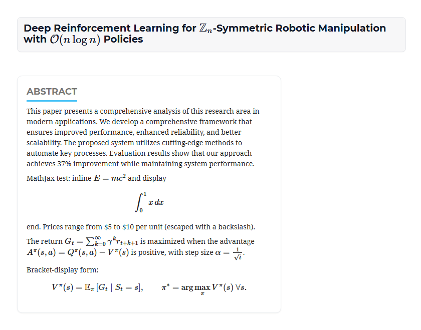 | 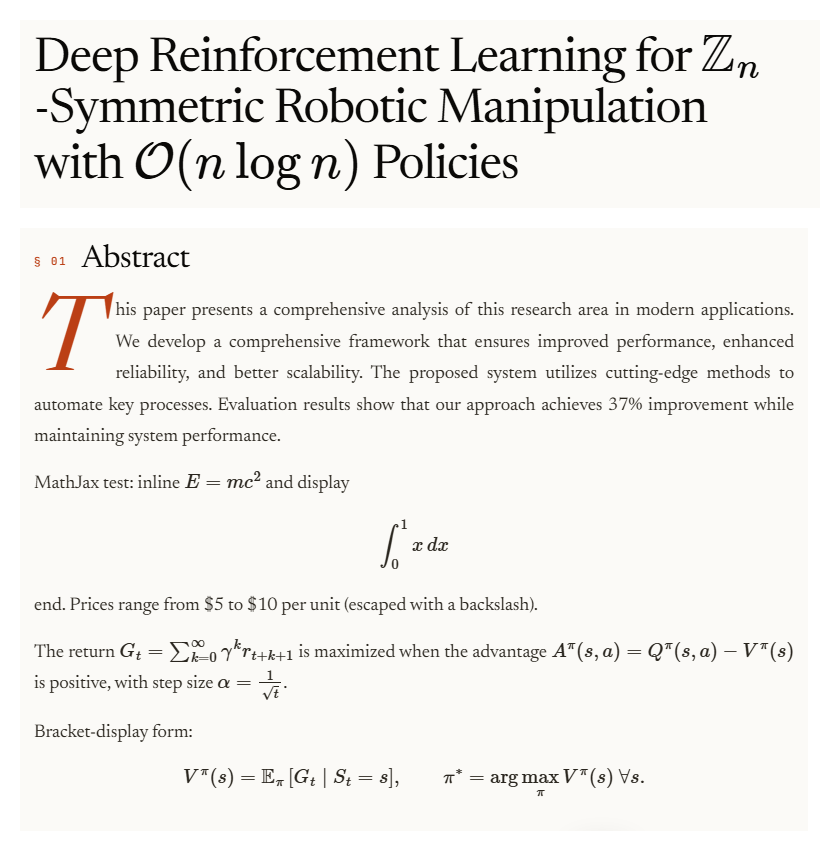 |
| References | 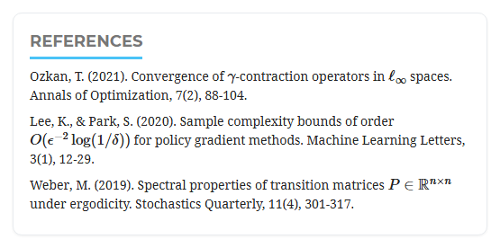 | 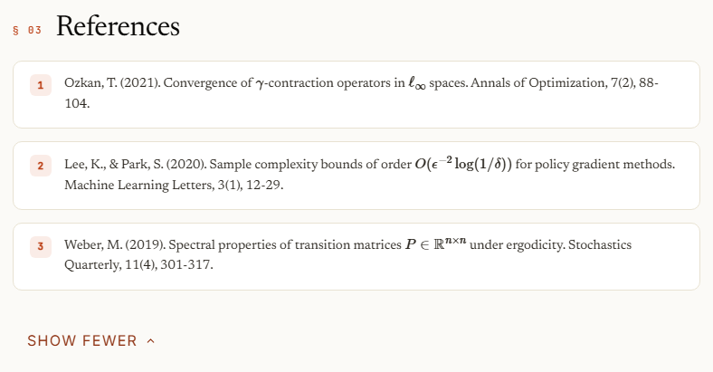 |
| How to cite | 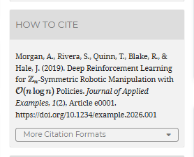 | 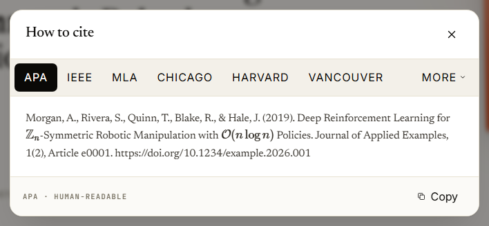 |
| After changing the citation style | 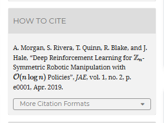 | 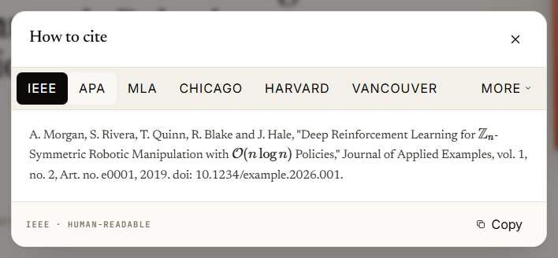 |
| HTML full text | 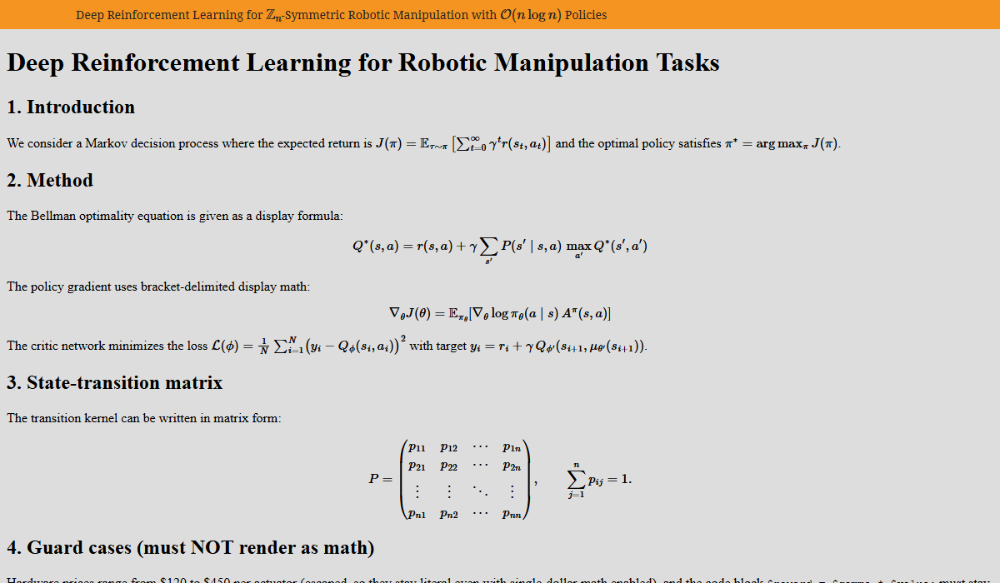 | 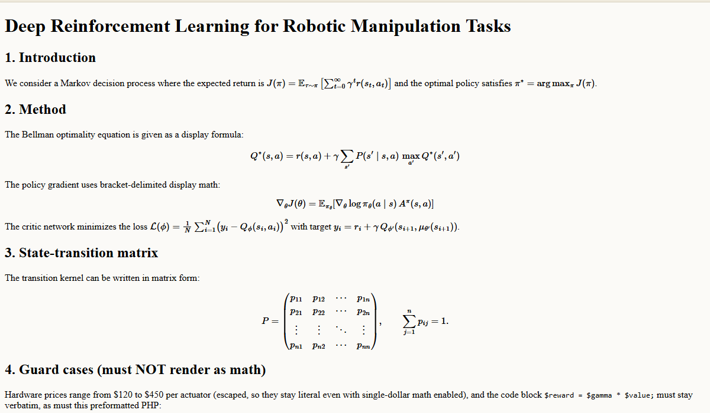 |

## Requirements

- **PHP:** the version your OJS release requires. The versions the plugin has been tested with
  are listed under *Compatibility*.
- The *HTML Article Galley* plugin, if you want mathematics rendered in HTML full texts.

## Compatibility

| Plugin version | OJS, tested in full | OJS, also checked by the automated regression run | PHP (full tests) | Package |
|---|---|---|---|---|
| 1.x (1.1.0.12) | 3.3.0.22 | 3.3.0.16, 3.3.0.20, 3.3.0.21 | 7.4, 8.1 | `mathJaxRender-ojs3.3-1.1.0.12.tar.gz` |
| 2.x (2.0.0.10) | 3.4.0.10, 3.5.0.5 | 3.4.0.3, 3.5.0.1, 3.5.0.3 | 3.4: 8.1, 8.2 — 3.5: 8.2 | `mathJaxRender-ojs3.4-3.5-2.0.0.10.tar.gz` |

"Tested in full" means that formula rendering was checked page by page: article title, abstract,
references, *How to cite* box, issue and search listings and HTML full texts. The automated
regression run checks that the plugin loads exactly once, with the configured source and
delimiters, on the article, issue, search and home pages. Other releases of these OJS lines have
not been tested. The two plugin versions are separate code lines because file extensions,
namespaces and the plugin loader differ between OJS 3.3 and 3.4+; that is the same split PKP uses
for its own plugins. In the source repository they are the branches `ojs-3.3` and `ojs-3.4-3.5`. Fixes are
applied to both.

## Installation

1. If another plugin that loads MathJax is installed, disable or remove it first: two plugins
   would load MathJax twice.
2. In OJS go to *Website Settings → Plugins → Upload A New Plugin* and upload
   the `mathJaxRender-ojs3.3-…` or `mathJaxRender-ojs3.4-3.5-…` package for your OJS release (see *Compatibility*).
3. Enable **MathJax for OJS** in the *Generic Plugins* list.
4. Click *Settings* to choose the enabled areas, the MathJax source and the delimiters.

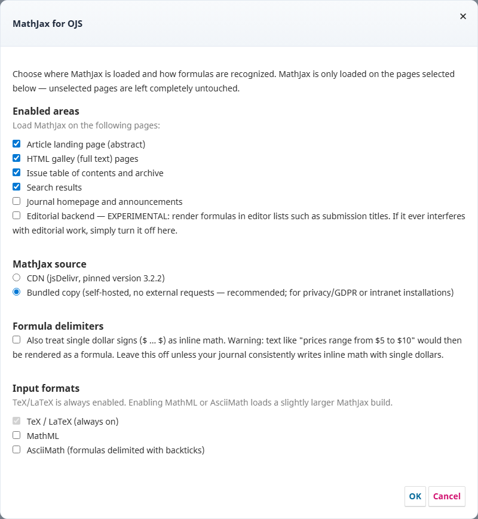

Installing through the plugin upload registers the plugin
automatically. If you instead copy the directory manually (e.g. a git checkout), OJS will
only load the plugin after it has been registered in the `versions` table — visiting
*Website Settings → Plugins* once as an administrator takes care of that.

## Writing math in OJS

Write formulas directly in the abstract or in HTML galleys:

- Inline: `\(E=mc^2\)`
- Display: `$$\int_0^1 x\,dx$$` or `\[ ... \]`
- With the single-dollar option enabled, `$E=mc^2$` also works (see the warning in the settings).

**Titles written with single dollars.** Mathematics journals commonly write titles as
`$\mathbb{Z}_n$-symmetric ...`. Those render in the editorial backend out of the box (backend
single-dollar is on by default), but on the reader-facing pages they stay as plain text until
you enable *Also treat single dollar signs as inline math*. Enable it if your journal writes
inline math that way — and in that case escape literal currency amounts as `\$5`, which this
plugin's configuration preserves as a plain dollar sign.

## External requests and privacy

- **Source: bundled copy (default).** The script and the fonts are served from the plugin's own
  `mathjax/` directory on your server. The plugin makes no request to any other address, so no
  visitor data leaves your site.
- **Source: CDN.** Select *CDN* in the plugin settings and, on the pages where the plugin is
  active, the visitor's browser downloads MathJax 3.2.2 — the script and its font files — from
  `cdn.jsdelivr.net`. As with any script hosted by a third party, the CDN operator sees the
  visitor's IP address, browser details and the address of the page. The plugin sends nothing to
  OJS Services.
- Pages where the plugin is not active load no MathJax files at all.

## Upgrading from OJS 3.3

The two plugin versions are not interchangeable. When you upgrade a journal from OJS 3.3 to
3.4 or 3.5:

1. Upgrade OJS as usual.
2. Delete the old `plugins/generic/mathJaxRender` directory (the 1.x version) and install the
   2.x package in its place (*Upload A New Plugin*, or copy the directory from the package).
   On OJS 3.5 the 1.x directory cannot be loaded — the server error log reports
   `Call to undefined function import()` and no formulas are rendered. OJS 3.4 still loads it,
   but it should be replaced as well.
3. Your settings are kept: they are stored in the database under the same plugin name, and
   they were unchanged after the switch. Clear the OJS data caches afterwards.

## Troubleshooting

- **Formulas do not appear after changing settings or enabling the plugin:** clear the OJS
  data caches (`cache/t_compile/*` and `cache/fc-pluginSettings-*.php`) or use
  *Administration → Clear Data Caches / Clear Template Cache*.
- **`<` and `>` disappear from formulas:** OJS sanitizes user-entered HTML with the
  `allowed_html` setting in `config.inc.php`. This plugin intentionally does **not** bypass
  core sanitization (security). If your journal needs raw `<`/`>` inside formulas, write
  them as TeX macros (`\lt`, `\gt`) or extend `allowed_html` at your own discretion.
- **Backslashes are stripped from references (e.g. `\gamma` becomes `gamma`):** this is
  OJS core behaviour; see *Known limits* for how to write formulas in references.
- **The self-hosted copy is selected but MathJax still loads from the CDN:** the plugin's
  `mathjax/` directory is missing (a partial upload, or files excluded during deployment).
  The settings form shows a warning and the server error log records the fallback. Re-install
  the plugin package to restore the directory, or switch the source to CDN.

## Known limits

- **PDF galleys are out of scope.** Mathematics inside PDF files is already typeset in the
  PDF itself; there is nothing for MathJax to do there.
- **HTML galley requirement:** full-text rendering requires the *HTML Article Galley* plugin
  to be enabled — that is the plugin that serves the galley document this plugin injects into.
  HTML galleys uploaded as complete documents with their own `</body>` and galleys served as
  bare fragments are both handled.
- **Backend rendering is experimental.** MathJax replaces text nodes with its own elements
  while Vue owns the same DOM; when a component re-renders, the formula is briefly replaced by
  its source text before the observer typesets it again. Editing, searching and saving always
  take priority: if backend rendering ever disturbs them, turn the option off — no editorial
  data is affected either way. Editing surfaces are excluded explicitly: plain `input` values
  are never text nodes, `textarea` is skipped by MathJax, and the rich-text editors (which run
  as `contenteditable` elements in the page) are marked so MathJax leaves them alone — an
  editor saving a title or abstract stores the original LaTeX, never MathJax's markup.
- **References lose single backslashes.** OJS core removes backslashes when it reads a stored
  reference (its `Citation` class calls `stripslashes()`), so `\(\gamma\)` is shown as `(gamma)`. The
  stored text is not changed. Until that core behaviour changes, write every backslash in the
  references field twice: `Ozkan, T. (2021). Convergence of \\(\\gamma\\)-contraction operators.`
  shows the formula, while the same text with single backslashes shows `(gamma)`. Titles,
  abstracts and galley files are not affected. Journals can copy this sentence into their
  author guidelines.
- **Shortened text.** Themes that shorten abstracts (issue and search result cards) can cut a
  formula in the middle; the visible fragment is then plain TeX.
- **Plain-text places.** The browser tab title, the `citation_title` and `DC.Title` meta tags and
  the page's structured data (JSON-LD) carry the title as it was entered, LaTeX included. The
  plugin leaves them unchanged.

## Third-party notices

- MathJax © The MathJax Consortium — Apache License 2.0.
  The bundled copy under `mathjax/` retains its Apache 2.0 license file (`mathjax/LICENSE`).
  Source: official npm package `mathjax@3.2.2` (checksum verified against the npm registry).

## Support

Developed by OJS Services (https://ojs-services.com). Questions and bug reports: please open an issue in this repository.

## License

GPL v3. See the [LICENSE](LICENSE) file. The bundled MathJax copy is distributed under the Apache License 2.0 (`mathjax/LICENSE`).
